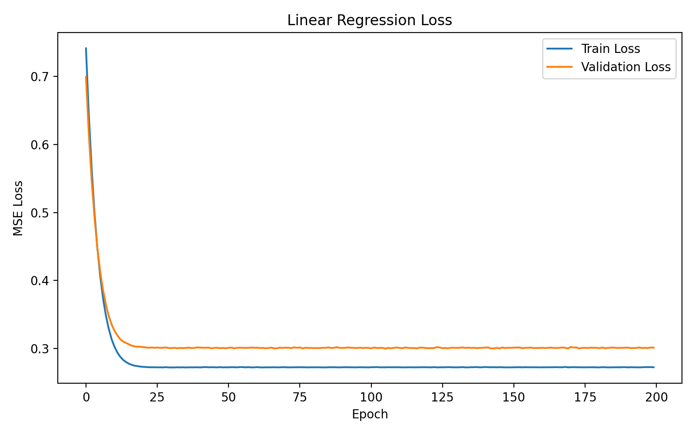
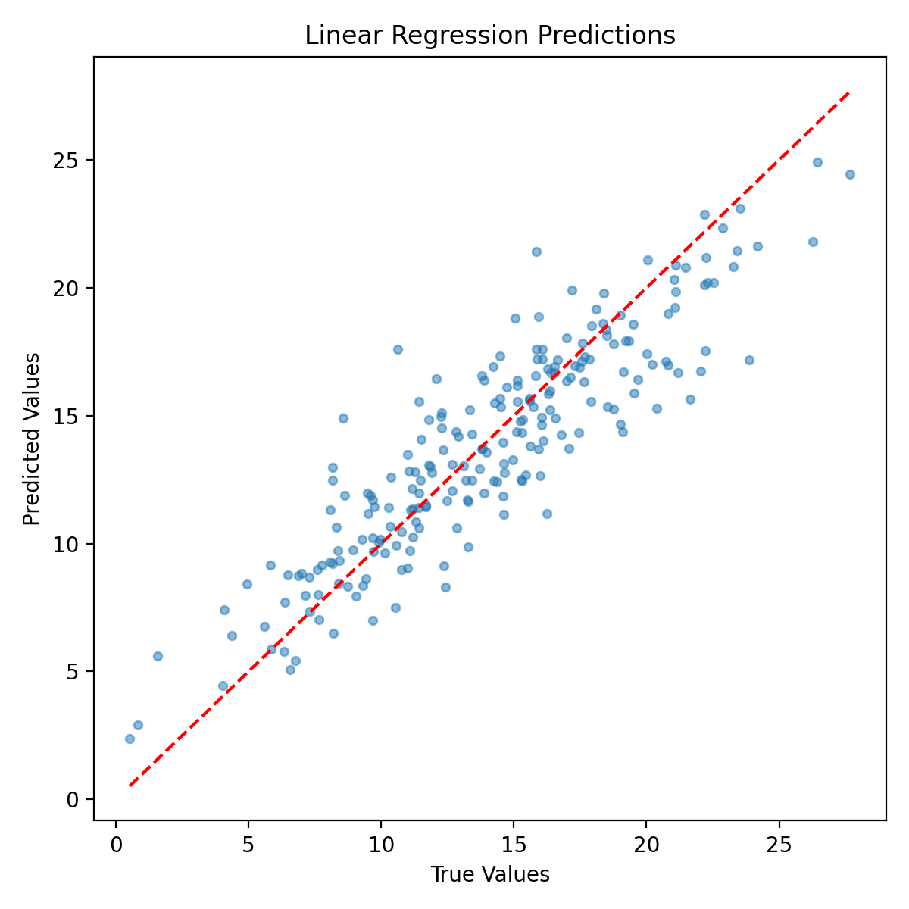
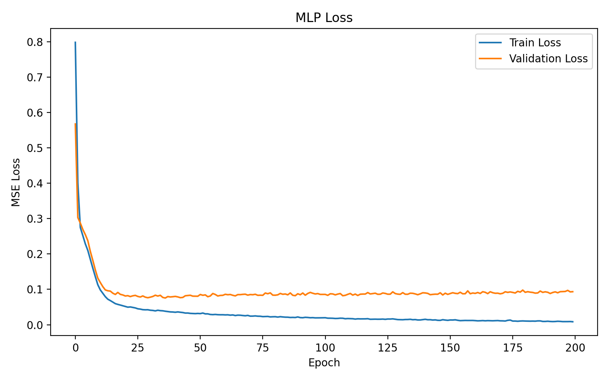
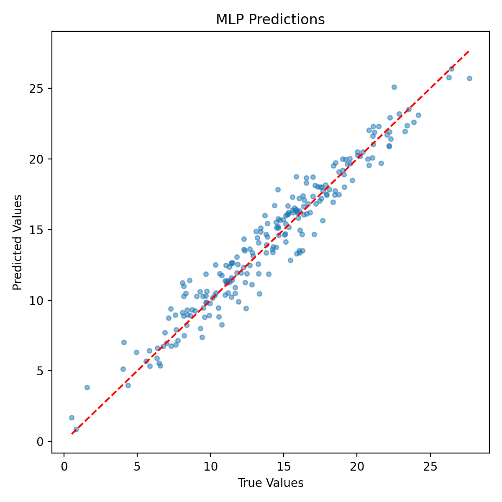
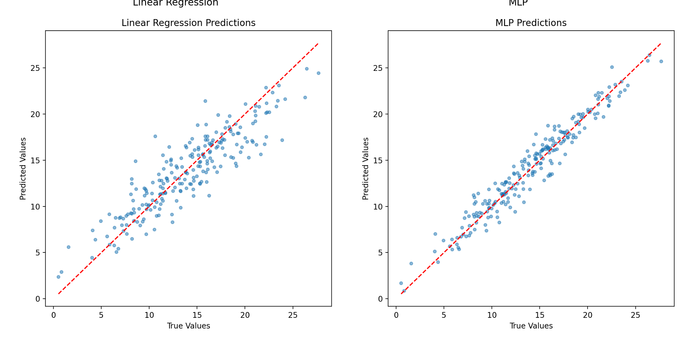

# 第二部分：从线性模型到神经网络——非线性回归

## 1. 实验代码

本次实验的代码分为三个文件：

- `linear.py`：线性回归模型的训练与测试。
- `mlp.py`：全连接神经网络的训练与测试。
- `comparison.py`：两个模型的预测结果对比。

## 2. 模型结构

使用 `make_friedman1` 生成 1500 条数据，每条数据包含 10 个特征，noise 设置为 1.0。

数据按照 70%、15%、15% 划分为训练集、验证集和测试集，并进行了标准化处理。

两个模型都使用 MSE 损失函数、Adam 优化器，学习率为 0.001，Batch Size 为 32，训练 200 轮。

### 2.1 线性模型

只有一个 Linear 层，没有隐藏层。

```text
Input(10)
Linear(10, 1)
Output(1)
```

参数量：11。

### 2.2 全连接神经网络（MLP）

加入两个隐藏层，并使用 ReLU 激活函数。

```text
Input(10)
Linear(10, 64)
ReLU
Linear(64, 32)
ReLU
Linear(32, 1)
Output(1)
```

参数量：2817。

## 3. 主要评价结果与对比

本次使用 MSE、MAE 和 R² 评价预测效果。MSE、MAE 越小越好，R² 越接近 1 越好。

| 模型 | MSE | MAE | R² | 参数量 |
|---|---:|---:|---:|---:|
| 线性模型 | 5.0434 | 1.7479 | 0.8005 | 11 |
| MLP | 1.4907 | 0.9566 | 0.9410 | 2817 |

MLP 的 MSE 比线性模型降低了约 70.4%，R² 也提高了 0.1405，说明 MLP 在这次任务中的预测效果更好。

## 4. 可视化结果

### 4.1 线性模型





### 4.2 MLP





### 4.3 两个模型对比



## 5. 实验结果分析

从 Loss 曲线来看，线性模型在训练前期下降得比较快，大约到第 20 轮后就基本稳定了，继续训练也没有明显改善。MLP 的训练 Loss 下降得更多，而且从预测图中可以看到，MLP 的预测点比线性模型更接近红色虚线，说明它的预测结果更准确。

我觉得主要原因是线性模型结构比较简单，只能学习线性关系，而 MLP 加入隐藏层和 ReLU 以后，可以学习更复杂的规律。不过 MLP 训练到后期时，训练 Loss 还在下降，验证 Loss 却有一点上升，说明可能出现了一些过拟合。

总体来看，MLP 在这次实验中的效果更好，但模型变复杂以后，也需要注意过拟合的问题。

## 6. 思考题

### 6.1 模型能力从哪里来？

我觉得模型的学习能力和它的结构有很大关系。线性模型只能学习比较简单的线性关系，而 MLP 加入隐藏层和 ReLU 以后，可以学习更复杂的非线性关系。这次实验中，线性模型的 MSE 是 5.0434，而 MLP 降到了 1.4907，说明改变网络结构确实提高了模型在这个任务中的预测能力。

### 6.2 更深一定意味着更强吗？

不一定。如果一个网络只是不断增加 Linear 层，中间没有激活函数，那么这些线性层最后还是可以合并成一个线性层。所以虽然网络变深了，但它本质上仍然是线性模型，表达能力没有发生本质变化。我觉得这说明增加网络层数不一定就能提高模型能力，还需要加入非线性操作。

### 6.3 模型越复杂越好吗？

不一定。虽然增加隐藏层和神经元数量可以提高模型学习复杂规律的能力，但也可能导致过拟合。比如这次 MLP 在训练后期，训练 Loss 还在下降，但是验证 Loss 有一点上升，说明训练集上的效果变好，并不代表对新数据的预测也会一直变好。所以我觉得模型不是越复杂越好，还需要根据实际的测试效果进行选择。