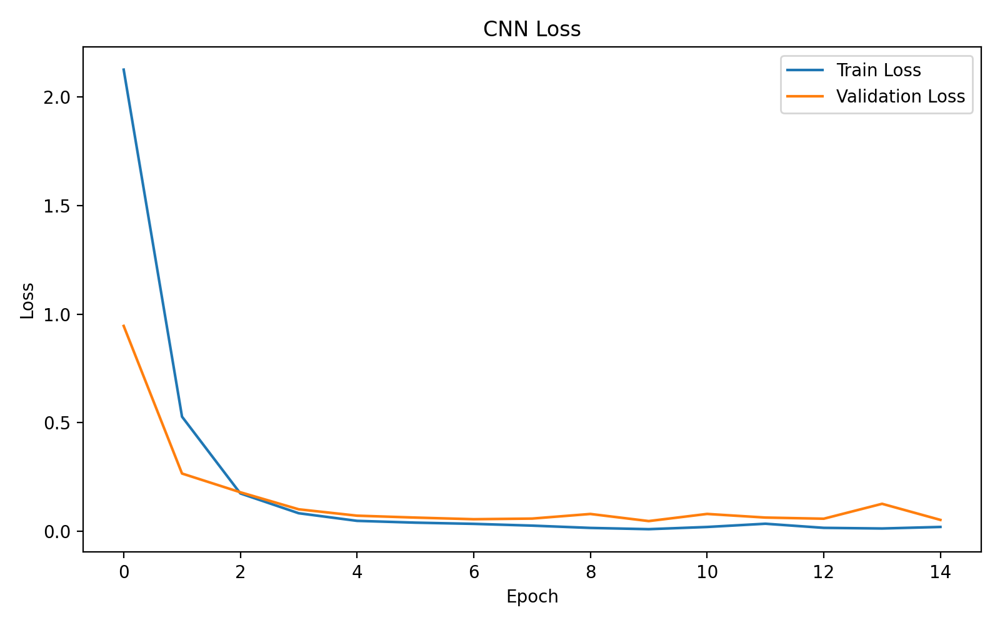
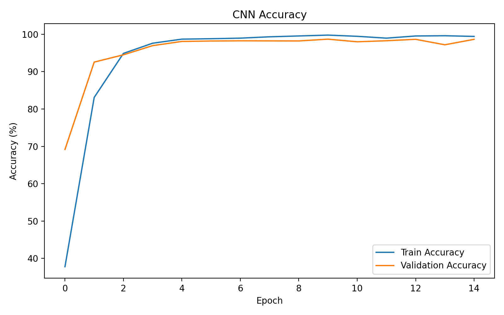
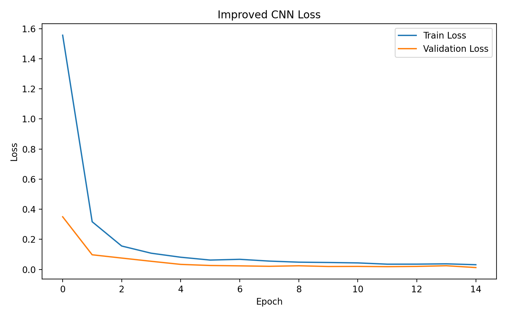
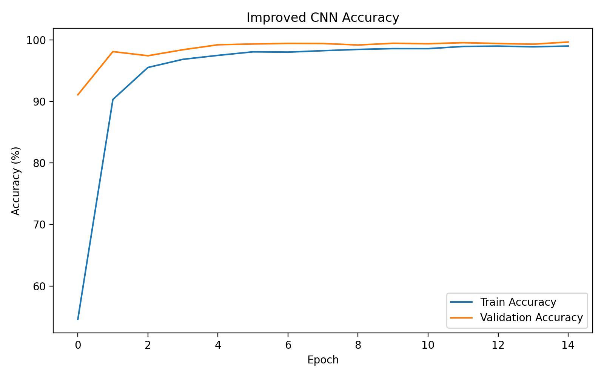

# 三、CNN 交通标志分类

## 1. 理论基础

### 1.1 卷积层是什么？在 CNN 中有什么作用？

卷积层是 CNN 中用来提取图片特征的网络层。

它通过卷积核在图片上滑动，提取边缘、颜色、纹理等信息。随着网络层数增加，模型可以逐渐学习到更复杂的特征，最后根据这些特征判断图片属于哪一类。

### 1.2 卷积层与全连接层相比有什么优势？

卷积层主要关注图片的局部区域，而且同一个卷积核可以在不同位置重复使用。

这样通常可以减少参数量，也能利用图片本身的空间信息。

相比之下，全连接层需要连接所有输入，处理较大图片时参数量可能很多，所以卷积层更适合提取图片特征。

### 1.3 卷积核越大越好吗？

不一定。

卷积核越大，每次看到的图片范围越大，但参数量和计算量通常也会增加。

很多 CNN 喜欢连续使用多个 3×3 卷积核，因为这样也能扩大感受野，而且可以在中间加入激活函数，让模型学习更复杂的特征。

### 1.4 Pooling 有什么作用？

Pooling 主要用于缩小特征图，减少计算量，同时保留一部分重要信息。

Max Pooling 会选择区域内最大的值，更关注明显的特征。

Average Pooling 会计算区域内的平均值，更关注整体信息。

### 1.5 什么是感受野？

感受野就是网络中某个位置的特征能够受到输入图片多大范围的影响。

前面的卷积层通常只能关注图片的一小部分，而经过多层卷积后，后面的特征可以利用更大范围的信息。

### 1.6 卷积输出尺寸计算

输入尺寸为 32×32×3。

卷积输出尺寸计算公式：

\[
O=\left\lfloor\frac{I+2P-K}{S}\right\rfloor+1
\]

第一层卷积：卷积核 5×5，步长 1，填充 2，输出通道数 16。

\[
O=\frac{32+2\times2-5}{1}+1=32
\]

所以卷积后尺寸为：

**32×32×16**

第二层最大池化：池化核 2×2，步长 2，不填充。

\[
O=\frac{32-2}{2}+1=16
\]

所以池化后尺寸为：

**16×16×16**

## 2. CNN 分类实验

### 2.1 数据集与训练设置

本次使用 GTSRB 交通标志数据集，共有 43 个类别。

训练前将所有图片统一调整为 32×32，并进行归一化处理。

从原始训练集中划分 80% 用于训练、20% 用于验证，另外使用数据集自带的测试集进行测试。

训练设置：

- Loss：CrossEntropyLoss
- 优化器：Adam
- 学习率：0.001
- Batch Size：64
- Epoch：15

### 2.2 基础 CNN 模型结构

模型使用三层卷积，每层卷积后加入 ReLU 和最大池化，最后通过全连接层完成分类。

```text
输入图片 (3×32×32)
        ↓
Conv2d(3,32) → ReLU → MaxPool
        ↓
Conv2d(32,64) → ReLU → MaxPool
        ↓
Conv2d(64,128) → ReLU → MaxPool
        ↓
Flatten
        ↓
Linear(2048,256) → ReLU
        ↓
Linear(256,43)
        ↓
输出43个类别的分数
```

### 2.3 基础 CNN 实验结果

| 指标 | 结果 |
|---|---:|
| Test Loss | 0.8636 |
| Test Accuracy | 87.49% |
| 最佳验证准确率 | 98.69% |

**Loss 曲线：**



**Accuracy 曲线：**



从曲线来看，模型前几轮的 Loss 下降得很快，准确率也不断提高，后面逐渐稳定。

不过测试集准确率只有 87.49%，比验证集低了不少，说明模型在测试图片上的表现还不够好。

## 3. CNN 模型改进

### 3.1 改进方法

在基础 CNN 上做了以下修改：

- 在卷积层后加入 BatchNorm，帮助模型更稳定地训练。
- 在全连接层加入 Dropout，减少过拟合的可能。
- 训练时增加随机旋转、亮度和对比度变化，让模型接触不同情况的交通标志图片。

改进后的模型仍然使用三层卷积，训练轮数和学习率保持不变。

### 3.2 改进后的模型结构

```text
输入图片 (3×32×32)
        ↓
Conv2d(3,32) → BatchNorm → ReLU → MaxPool
        ↓
Conv2d(32,64) → BatchNorm → ReLU → MaxPool
        ↓
Conv2d(64,128) → BatchNorm → ReLU → MaxPool
        ↓
Flatten
        ↓
Linear(2048,256) → ReLU → Dropout(0.3)
        ↓
Linear(256,43)
        ↓
输出43个类别的分数
```

### 3.3 改进后的实验结果

| 指标 | 结果 |
|---|---:|
| Test Loss | 0.2209 |
| Test Accuracy | 95.30% |
| 最佳验证准确率 | 99.66% |

**Loss 曲线：**



**Accuracy 曲线：**



从曲线来看，改进后的模型在前几轮准确率就提高得很快，后面逐渐稳定。训练 Loss 和验证 Loss 都下降到了比较低的水平。

## 4. 改进前后结果对比

| 评价指标 | 基础 CNN | 改进 CNN |
|---|---:|---:|
| Test Loss | 0.8636 | 0.2209 |
| Test Accuracy | 87.49% | 95.30% |
| 最佳验证准确率 | 98.69% | 99.66% |

改进后测试准确率从 87.49% 提高到了 95.30%，提高了 7.81 个百分点，测试 Loss 也明显降低。

## 5. 实验结果分析

从这次实验来看，基础 CNN 已经能够识别大部分交通标志，但是验证集准确率和测试集准确率之间有比较明显的差距。

改进模型之后，测试准确率提高到了 95.30%，说明这次修改整体上是有效的。

我觉得数据增强可能起到了一定作用，因为交通标志在实际图片中可能存在不同的角度和光照情况，训练时加入这些变化，可以让模型接触到更多不同的图片。

另外，BatchNorm 和 Dropout 也可能帮助模型训练得更加稳定，减少对训练数据的过度依赖。

不过这次同时修改了三个地方，所以还不能确定具体是哪一个改动的作用最大。

总体来看，改进后的 CNN 在测试集上表现更好，也让我发现，除了网络结构以外，数据处理和训练方法同样会影响模型的最终效果。